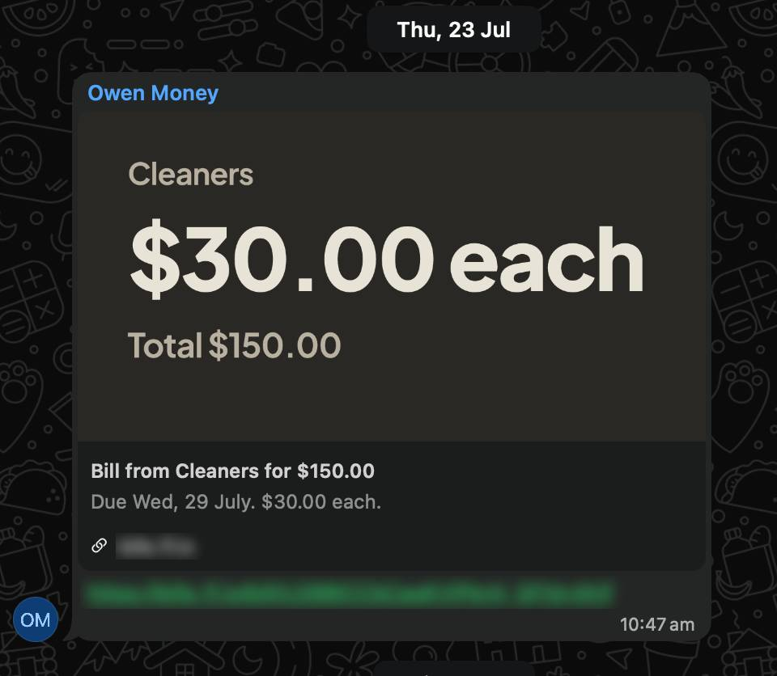
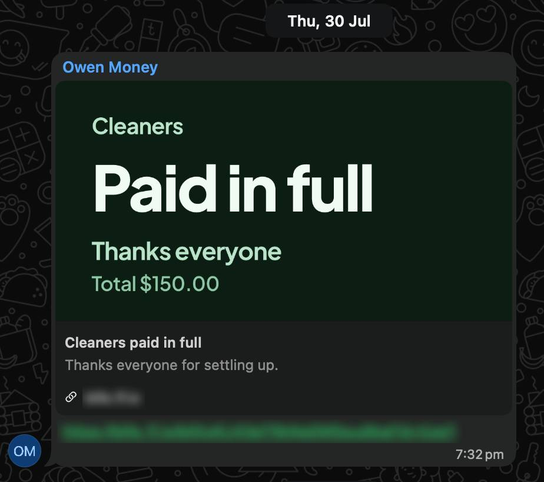

# Sharehouse Bills

Sharehouse Bills is a full-stack household billing app. It turns emailed,
uploaded, and recurring bills into per-housemate shares, queues incoming Up
Bank transfers for an admin to confirm, and keeps the house updated through
WhatsApp.

## WhatsApp integration

New and settled bills are shared as rich link previews, so the house can see the
important details without opening the app.

<table>
  <tr>
    <td width="50%">
      
    </td>
    <td width="50%">
      
    </td>
  </tr>
  <tr>
    <td align="center"><strong>New bill</strong></td>
    <td align="center"><strong>Paid in full</strong></td>
  </tr>
</table>

The WAHA-powered integration:

- posts a bill card to the configured group when a bill is created
- posts a settled card when a shared bill is paid in full
- sends each housemate at most two kinds of private message: one overdue
  digest a day while anything is overdue, and one receipt per confirmed
  payment (or a correction when an admin changes what it covered)
- tells the owner privately when a housemate's payment arrives and needs a
  decision
- answers private natural-language questions about balances, bill breakdowns,
  overdue and upcoming bills, payment history, receipts, and pay links
- responds to group commands such as `due` while ignoring ordinary group chat;
  admin commands include `/paylinks` (send every housemate their pay link) and
  `/reminder` (preview today's overdue digests without sending them)
- generates custom Open Graph cards for bill, pay, and receipt links
- verifies inbound webhook HMACs and runs delivery through tracked, retryable
  workflows

Inbound WhatsApp events are handled at `POST /api/hooks/whatsapp`.

## Features

### Bill ingestion and management

- Receive PDF bills through a verified Resend inbound webhook at
  `POST /api/hooks/email`.
- Upload PDF bills manually from the dashboard.
- Extract known AGL, Hudson McHugh, and Neptune bill formats directly, with
  Vertex AI/Gemini as the general PDF fallback.
- Store source PDFs in Vercel Blob and avoid duplicate bill imports.
- Split bills across selected housemates using equal or custom amounts.
- Track pending, partially paid, and paid bills, including each housemate's
  outstanding share and the payments that covered it.
- Tick bills off on the Bills page once their payments look right.
- Manage housemates, bank aliases, WhatsApp numbers, and active status.

### Recurring bills and the overdue digest

- Create reusable weekly, fortnightly, monthly, or yearly bill templates.
- Use equal or custom splits and choose the participating housemates.
- Pause, resume, edit, delete, preview, or manually generate templates.
- Generate due templates automatically through the authenticated cron route.

The cron route, `GET /api/cron`, runs daily at 00:00 UTC (`vercel.json`). It
generates due recurring bills and queues the overdue digest. It requires
`CRON_SECRET` as a bearer token or `secret` query parameter.

The overdue digest is one private WhatsApp message per housemate per Sydney
day, only when something is overdue after their held credit is applied. It
lists each overdue bill oldest first (at most eight, then `+N more`), says how
much credit is already applied, and links to the housemate's pay page. The
event key `overdue-digest:<housemateId>:<YYYY-MM-DD>` makes a rerun of the cron
the same day send nothing new, and the workflow recomputes the digest before
sending so a payment confirmed in between cancels it. There are no per-bill
reminders.

### Up Bank payments and housemate accounts

Nothing is credited or allocated automatically. Every receipt is an admin
decision. The full model is in [docs/payments.md](./docs/payments.md).

- **One model.** A bill share is what a housemate owes; a receipt is money in
  from them; an allocation says which receipt paid which share. Paid,
  remaining, credit, owed, overdue, balance and bill status are all derived
  from those three tables by one module. All money is integer cents.
- **Bank transactions.** `POST /api/hooks/up` verifies Up's signature, fetches
  the full transaction, and records `TRANSACTION_CREATED` and
  `TRANSACTION_SETTLED` events. Own-account transfers, interest, merchant
  refunds and unrecognised senders are set aside. Activity from an identified
  housemate, or naming several housemates, waits in the Payment review queue,
  and the owner gets a WhatsApp message when it is money in.
- **Payment review.** For each transfer the admin confirms the suggested bills,
  changes them, keeps the money as credit, splits a shared transfer between
  housemates, records a household refund, or marks it as not a bill.
  Suggestions are advisory: the oldest open share the amount exactly matches,
  then an exact combination. Rent-only references only pay rent bills.
- **Held credit.** Money that is not allocated to a bill is held as credit.
  Every figure for what a housemate owes or has overdue (pay page, statement,
  overdue digest, pay links, assistant, Housemates page) applies it to open
  shares oldest due first, so they all agree.
- **Accounts.** The Accounts page shows each housemate's shares, receipts and
  statement with a running balance. The admin can reallocate any receipt; the
  housemate gets a receipt the first time and a correction when a later change
  differs.
- **Cash.** Recording cash on the Accounts page is the only manual payment.
  The admin enters the amount, date and note once; the app proposes the
  housemate's open shares oldest due first, the admin can change the split,
  and one cash receipt is written with its allocations (anything left is held
  as credit). The housemate gets a WhatsApp receipt that says cash was
  received.
- **Corrections.** Receipts are never deleted, only voided with a reason. If
  the bank changes or deletes a confirmed transaction, its receipts are voided
  and it goes back to review; a new decision on a transaction voids the
  receipts it replaces. Deleting a bill releases its allocations back to
  credit.
- **Notifications.** A housemate's receipt is queued in the same transaction as
  the decision, and the group's paid-in-full card is queued in the allocation
  that pays a bill's last housemate share.

### Public payment views

- Public bill pages show the total, per-person split, due date, and payment
  progress.
- Signed housemate pay links group outstanding bills, show what held credit
  already covers, and show what remains.
- Each pay link has a statement of bill shares and payments received.
- Signed receipt links confirm a settled share and link back to any remaining
  balance.
- Dedicated Open Graph image routes produce the WhatsApp cards shown above.

## Architecture

- **Application:** TanStack Start, React 19, Vite, and Nitro
- **UI:** Tailwind CSS 4, shadcn/ui, Radix UI, and Recharts
- **Database:** Drizzle ORM with SQLite/Turso
- **Authentication:** Better Auth
- **Bill extraction and assistant:** Google Vertex AI/Gemini
- **Email:** Resend inbound webhooks and result notifications
- **Payments:** Up Bank API and signed webhooks
- **WhatsApp:** WAHA plus durable workflow jobs
- **File storage:** Vercel Blob
- **Observability:** evlog structured request and workflow logging

## Getting started

### Prerequisites

- [Bun](https://bun.sh/) 1.2 or newer
- a Turso/libSQL database
- the provider credentials for whichever integrations you enable

### Installation

```bash
git clone https://github.com/jmcmullen/sharehouse-bills.git
cd sharehouse-bills
bun install
cp .env.example .env
```

Configure `.env` before starting the app. The main groups are:

| Capability | Environment variables |
| --- | --- |
| App and database | `VITE_BASE_URL`, `DATABASE_URL`, `DATABASE_AUTH_TOKEN`, `BETTER_AUTH_SECRET` |
| Bill PDFs and AI | `BLOB_READ_WRITE_TOKEN`, `GOOGLE_CLOUD_REGION`, `GOOGLE_VERTEX_PROJECT`, `GOOGLE_CLIENT_EMAIL`, `GOOGLE_PRIVATE_KEY` |
| Resend email | `RESEND_API_KEY`, `RESEND_WEBHOOK_SECRET`, `WEBHOOK_EMAIL_TO`, `WEBHOOK_EMAIL_FROM` |
| Up Bank | `UP_BANK_API_TOKEN`, `UP_BANK_WEBHOOK_SECRET`, `PAY_ID` |
| WhatsApp/WAHA | `WAHA_BASE_URL`, `WAHA_API_KEY`, `WAHA_SESSION_NAME`, `WAHA_WEBHOOK_SECRET`, `WHATSAPP_GROUP_CHAT_ID`, `WHATSAPP_ADMIN` |
| Public links and automation | `REMINDER_LINK_SECRET`, `CRON_SECRET`, `RECURRING_BILL_GENERATION_LEAD_DAYS` |

Push the schema and start the development server:

```bash
bun db:push
bun dev
```

The app runs at [http://localhost:4000](http://localhost:4000). For local Resend
webhook setup with Cloudflare Tunnel, see
[docs/local-webhooks.md](./docs/local-webhooks.md).

## Available scripts

| Command | Purpose |
| --- | --- |
| `bun dev` | Start Vite on port 4000 |
| `bun run build` | Create a production build |
| `bun serve` | Preview the production build |
| `bun test` | Run the test suite (Bun's built-in runner) |
| `bun typecheck` | Run TypeScript without emitting files |
| `bun check` | Run Biome formatting, linting, and import organization |
| `bun fallow` | Find dead code and duplication |
| `bun tunnel` | Run the configured Cloudflare tunnel |
| `bun db:push` | Push the current Drizzle schema |
| `bun db:generate` | Generate Drizzle migrations |
| `bun db:migrate` | Apply database migrations |
| `bun db:studio` | Open Drizzle Studio |
| `bun db:seed` | Seed local development data |
| `bun db:repair-recurring` | Repair recurring-bill generation dates |
| `bun ledger` | Import Up history (`--import-up [--since ISO]`, `--bank-file file.json`) or write an account report (`--report file.json`) |

## Project structure

```text
sharehouse-bills/
├── src/
│   ├── api/
│   │   ├── db/                 # Drizzle connection, schema, and migrations
│   │   ├── scripts/            # Migration, seed, and ledger CLI scripts
│   │   └── services/           # Domain logic and external integrations
│   │       ├── account/        # Every money derivation (paid, credit, owed)
│   │       └── payments/       # Bank ingest, decisions, allocations, cash
│   ├── components/             # Feature components and UI primitives
│   ├── functions/              # Authenticated TanStack server functions
│   ├── lib/                    # Shared application utilities
│   └── routes/                 # App pages, public views, and API handlers
├── workflows/                  # Retryable WhatsApp delivery workflows
├── docs/                       # Payments model, screenshots, webhook notes
├── public/                     # Static assets
├── drizzle.config.ts
├── vite.config.ts
└── package.json
```

`src/routeTree.gen.ts` is generated by TanStack Router and should not be edited
manually.

## Contributing

Before opening a pull request, run:

```bash
bun test
bun check
bun typecheck
bun run build
```

Use concise Conventional Commit subjects such as `fix: handle duplicate bill`
or `feat: add payment receipt`.
